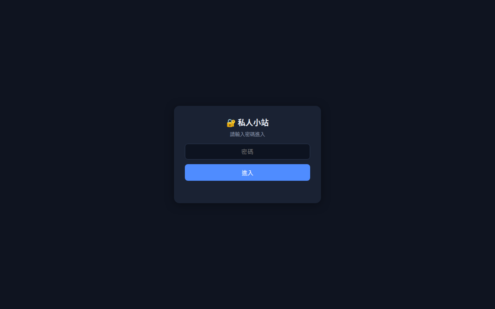
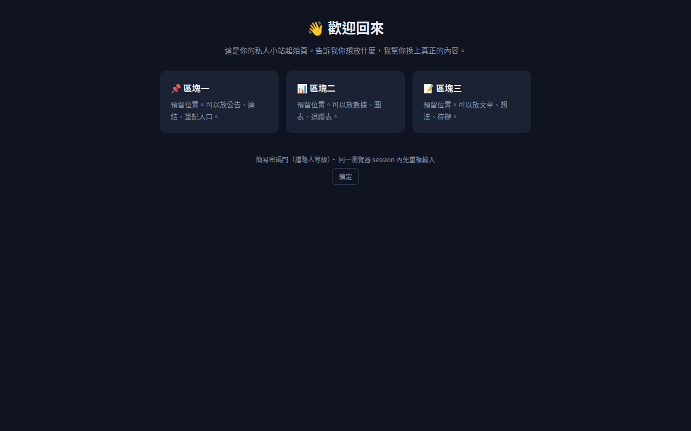

# 🔐 私人小站（Drive Vault）

一個「輸入密碼才看得到」的靜態網站，部署在 GitHub Pages（免費）。

🌐 線上網站：https://hebe2234.github.io/drive-vault/

## 這是什麼

- Public GitHub repo + GitHub Pages，前端密碼門擋住內容
- 密碼以 SHA-256 hash 存在網頁裡，不存明文；同一個瀏覽器 session 內免重複輸入
- 純靜態、零後端、零費用

## 怎麼做到的（教學）

### 1. 建一個 public repo

免費 GitHub 帳號的 Pages **一定要 public repo** 才能發布（private repo 要 Pro）。
在 GitHub 按 New repository，取名例如 `drive-vault`，選 Public。

### 2. 寫 `index.html`

整個網站就是一個 `index.html`，重點只有三段：

- **密碼門 UI**：一個置中的密碼輸入框
- **驗證邏輯**：用 `crypto.subtle.digest` 算輸入的 SHA-256，跟寫死在 JS 裡的 `PASS_HASH` 比對
- **內容區**：驗證通過才顯示，`sessionStorage` 記住狀態，關掉分頁就重鎖

### 3. 上傳到 repo

把 `index.html`（和 `.nojekyll`）推到 repo 的 `main` 分支根目錄。

### 4. 開啟 GitHub Pages

Repo → Settings → Pages → Build and deployment → Source 選 **Deploy from a branch**，
Branch 選 `main`、資料夾選 `/ (root)`，按 Save。約一分鐘後上線。

### 5. 實際長這樣

輸入密碼前只看得到密碼門：



密碼正確後進入內容：



## 換密碼

密碼不要寫明文在程式碼裡，只存它的 SHA-256。產生 hash：

```bash
printf '%s' '你的新密碼' | sha256sum
```

把輸出的 hash 貼到 `index.html` 裡的 `PASS_HASH`，重新上傳即可。

## 限制（重要）

這是**擋路人等級**的密碼門：hash 攤在公開原始碼裡，短密碼擋不住暴力破解。
真正的機密資料不要放上來；要真安全請改用 Cloudflare Pages + Cloudflare Access。
