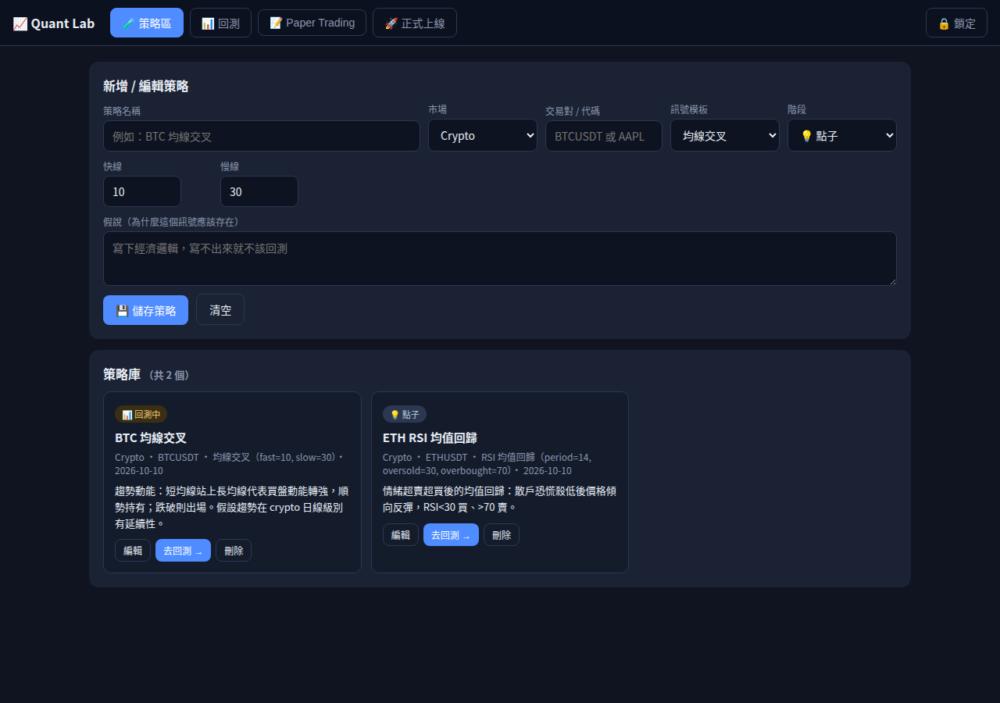

# 📈 Quant Lab｜量化工作台

一個「輸入密碼才看得到」的量化交易 GUI，四個階段：**策略區 → 回測 → Paper Trading → 正式上線**。

🌐 線上網站：https://hebe2234.github.io/drive-vault/（密碼門後方）

## 功能

### 🧪 策略區
策略庫的新增 / 編輯 / 刪除，每個策略記錄：市場、交易對、訊號模板、參數、**假說**（寫不出經濟邏輯就不該回測）、階段（點子 → 回測中 → Paper → 實盤 → 淘汰）。資料存在瀏覽器 localStorage。
- **查看策略詳情**：每張卡可展開看完整訊號邏輯、參數、上次回測成績
- **✏️ 自訂程式碼**：模板選「自訂程式碼」，自己寫 `function signal(i, closes, p)`（回傳 1=買、-1=賣、0=無），可用 `sma(n,i)`、`rsi(period)[i]`、`boll(period,mult).up/.dn[i]`，參數用 JSON 自定。回測和 paper 自動跑都支援自訂策略。



### 📊 回測
- 資料：Binance 免費 K 線（免 API key）或上傳自己的 CSV（`date,open,high,low,close`）
- 引擎：純前端向量化回測，做多全倉進出，手續費可調
- 輸出：總報酬、年化 Sharpe、最大回撤、勝率、Profit Factor、權益曲線圖、交易明細

### 📝 Paper Trading
$100,000 虛擬帳戶，用 Binance 即時市價模擬成交：
- 手動買賣、持倉與未實現損益、成交紀錄
- 策略自動跑：選策略＋頻率，定時用最新已收盤 K 棒算訊號自動虛擬下單

### 🚀 正式上線
- 實盤候選清單、⛔ 緊急全部平倉（虛擬倉位）kill switch
- 真實券商（Alpaca 等）串接指引：API key 需要後端保管，本版尚未內建

## 怎麼做到的（教學）

1. **建 public repo**：免費 GitHub 帳號的 Pages 一定要 public repo（private 要 Pro）
2. **寫三個檔**：`index.html`（版面＋四個分頁）、`styles.css`、`app.js`（策略 CRUD、指標、回測引擎、paper 帳戶）
3. **密碼門**：`crypto.subtle` 算輸入密碼的 SHA-256，跟寫死在 JS 的 `PASS_HASH` 比對；`sessionStorage` 記住 session
4. **上傳**到 repo 根目錄，加 `.nojekyll`
5. **Settings → Pages** → Deploy from a branch → `main` / `/ (root)`，約一分鐘上線

## 換密碼

```bash
printf '%s' '你的新密碼' | sha256sum
```

把 hash 貼到 `app.js` 的 `PASS_HASH`，重新上傳。

## 限制

- 密碼門是**擋路人等級**（hash 公開在原始碼），機密資料不要放
- 回測假設以收盤價成交、無滑價；歷史績效不代表未來
- 真實下單需要後端保管 API key，目前只到虛擬 paper
